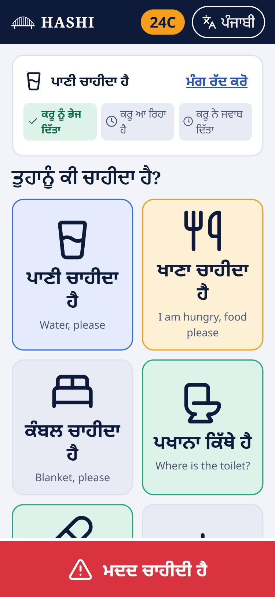
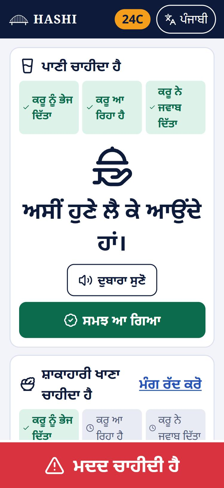
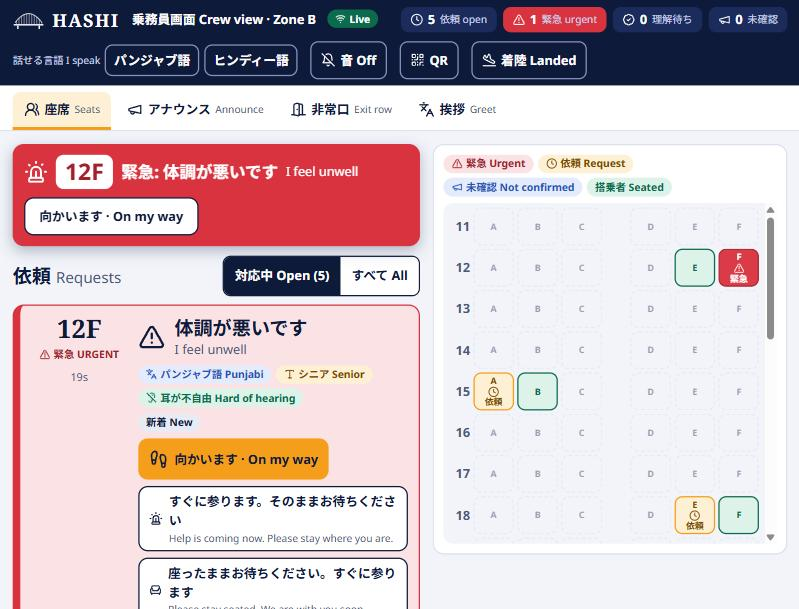
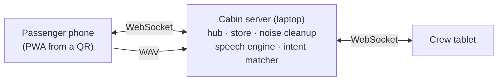

# HASHI 橋 / पुल / ਪੁਲ

**Don't translate. Understand.**

HASHI is a cabin communication layer for flights between India and Japan. A passenger who speaks
Hindi or Punjabi taps a picture or speaks; the crew tablet shows a card in Japanese with an English
subtitle; the reply comes back as a picture, audio and large text; the passenger taps "understood" and the
crew can see who has not. It runs on one laptop over its own Wi-Fi, with no internet.

Built for the Thapar Japan Hackathon 2026, problem **JAL-PS-02** (passenger and crew communication
across accents and language barriers).

| Passenger phone (Punjabi, senior mode) | The reply: picture, large text, audio, "understood" | Crew tablet (Japanese with English subtitle) |
| --- | --- | --- |
|  |  |  |

## The idea

Free translation of noisy, accented speech is unreliable, and nobody checks that a translation landed.
HASHI does three smaller things well:

1. **Anticipate.** A private Comfort Profile (language, senior mode, vegetarian, hearing, mobility) appears to crew as a seat chip. A greeting coach shows crew a few words in the passenger's language spelled in katakana.
2. **Understand.** The passenger taps a picture tile or holds a button and speaks (Hindi, Punjabi, Hinglish). HASHI matches what was said against a **closed list of about 40 cabin requests** instead of transcribing everything, which is far kinder to accents and noise. If it is not sure it shows the top pictures ("Did you mean…?") rather than guessing.
3. **Confirm.** The crew reply with one tap. The passenger receives picture, audio and large text and taps "understood". Announcements are tracked the same way, and an exit-row check confirms the passenger understood (teach-back).

Fallback ladder: tap a picture, speak, show a card, call a human. HASHI only flags urgency. It never diagnoses and the crew stay in charge.

## Quick start

You need Python 3.11+ and Node 20+.

```bash
python -m venv .venv
.venv/bin/pip install -r server/requirements.txt -r server/requirements-voice.txt   # Windows: .venv\Scripts\pip
cd web && npm install && npm run build && cd ..
python scripts/get_models.py small     # speech model, once (internet needed once)
python scripts/gen_audio.py            # reply and announcement audio, once

python run.py --https --demo           # one command to run
```

Open the crew address the terminal prints on the tablet, tap **QR**, scan it with a phone. `--https` lets
phones use the microphone (see [docs/offline-setup.md](docs/offline-setup.md) for the hotspot steps).
`make dev` and `make demo` do the build and start for you where `make` is available.

Without the optional voice packages everything still works; voice then falls back to picture tiles.

## What is in the box

| Area | What it does |
| --- | --- |
| Passenger PWA (`/p`) | QR landing, language pick (Punjabi, Hindi, English), consent screen, Comfort Profile, picture tiles, senior mode (larger text and tiles), voice button, request status (sent, crew coming, replied, understood), one big help button |
| Crew dashboard (`/crew`) | Live request cards in Japanese and English, urgency sort with a pinned red banner for urgent requests, seat map, one-tap replies, announcement composer with an "understood" board, exit-row check panel, katakana greeting coach, language flags so Punjabi- and Hindi-speaking crew spot their passengers |
| Voice | Browser records 16 kHz audio, server cleans noise, local speech engine, intent matcher with top-3 and confidence, confirm-if-unsure, tiles on any error |
| Offline | Single laptop server, local fonts, service workers, auto-reconnect with queued requests |
| Privacy | Consent first, voice processed in memory only, no names, per-flight data in memory and wiped at landing |

About 40 requests are covered, from water and blankets to chest pain and smoke. Urgent ones go to the
crew at a lower confidence bar. See `data/intents/intents.yaml`.

## Architecture



More detail and a request walkthrough in [docs/architecture.md](docs/architecture.md).

## Tests and checks

```bash
python -m pytest server/tests -q        # catalogue, matcher, store, hub, voice pipeline
python -m ruff check server bench scripts run.py
cd web && npm run build                 # type-check and build
```

## Noise benchmark

`python -m bench.run` compares plain speech-to-text plus translation against HASHI's intent matching at
two noise levels for Hindi and Punjabi, and writes [bench/REPORT.md](bench/REPORT.md). Read the limits
there first: clips are synthetic voices and synthetic cabin noise until the team adds real recordings
(instructions in [bench/README.md](bench/README.md)).

BENCHMARK_SUMMARY

## Limitations (honest list)

* **Not yet tested on real devices.** Developed and checked in desktop browsers (including a phone-sized window). The microphone, hotspot reconnects and `--https` certificate flow still need a test on real phones.
* **Language content is unreviewed.** Hindi, Punjabi and Japanese strings, including the katakana greetings, have not been checked by native speakers. The checklist is `data/intents/REVIEW.md`.
* **Benchmark uses synthetic voices and noise.** Real accents, seniors and real cabin noise will score lower.
* **Speech engine.** Whisper-family (small, CPU) is used because it installs reliably; Punjabi quality is the weakest link, which is why the closed list and the confirm step exist. IndicConformer is the planned upgrade behind the same interface.
* **Noise cleanup** is simple spectral gating, not a trained suppressor.
* **Mocked:** passenger Comfort Profiles come from the passenger's own phone or from the demo seeding script; there is no airline reservation, meal or crew-roster link.
* **Closed list.** Requests outside the list fall back to pictures or a human by design.
* **Reply audio** is prepared in advance by a setup script that uses online voices; the cabin server never needs the internet afterwards. If a file is missing the phone reads the text itself.
* **No crew login by default.** Anyone on the cabin network can open `/crew`. Set `HASHI_CREW_PIN` to require a PIN on the tablet; a proper per-crew login is future work.
* **Crew routing by language** is a visual flag on the tablet, not an automatic assignment.

## Repository layout

```
server/      FastAPI app: hub, store, intents, matcher, phonetic folding, voice pipeline, tests
web/         passenger and crew apps (React, TypeScript, Vite), local fonts, service workers
data/        intents.yaml, replies, announcements, greetings, phrase banks, generated audio
bench/       noise benchmark, test sentences, report generator
docs/        architecture, privacy, offline setup, demo script, business notes
scripts/     model download, audio generation, demo traffic, small helpers
```

## Team

Built by the HASHI team for the Thapar Japan Hackathon 2026.

## Licence

MIT, see [LICENSE](LICENSE).
