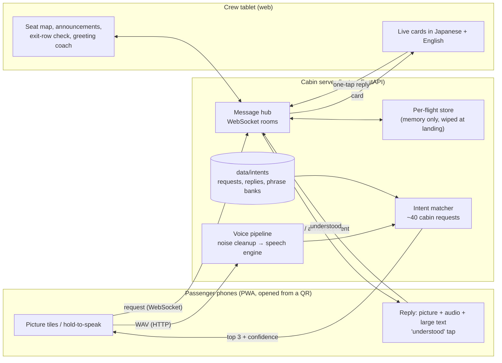

# Architecture

HASHI runs as **one process on a laptop** that acts as the cabin server. Passenger phones and the
crew tablet join it over the laptop's own Wi-Fi hotspot. Nothing needs the internet.

## Parts

| Part | Where | Job |
| --- | --- | --- |
| Message hub | `server/hashi/hub.py` | Keeps the WebSockets of phones and tablets, turns messages into store changes, pushes updates to whoever needs them. |
| Flight store | `server/hashi/store.py` | Seats, requests, announcements and their "understood" marks, exit-row checks. In memory only. Knows nothing about sockets, so it is easy to test. |
| Catalogue | `server/hashi/intents.py`, `data/intents/*.yaml` | The closed list of requests with labels in four languages, urgency, icon and one-tap replies. |
| Phonetic folding | `server/hashi/phonetic.py` | Rewrites Devanagari, Gurmukhi and roman spellings into one rough sound form, so one phrase bank serves all scripts. |
| Intent matcher | `server/hashi/matcher.py` | Scores the heard text against every phrase and returns the top three with a confidence and a decision: send, confirm or show tiles. |
| Voice pipeline | `server/hashi/voice.py`, `noise.py`, `asr/` | WAV in memory, spectral-gating noise cleanup, speech engine behind an `ASRBackend` interface. Nothing is stored. |
| Passenger app | `web/src/passenger` | Onboarding with consent, picture tiles, senior mode, big help button, voice button, request status. |
| Crew app | `web/src/crew` | Live request cards, seat map, announcement composer and "understood" board, exit-row check, greeting coach. |

## A request, end to end

1. The passenger scans the QR. The phone opens `/p/?seat=24C`, loads the catalogue (cached for offline), asks for a language and consent.
2. The phone opens a WebSocket to `/ws/passenger?seat=24C` and sends `hello` with the Comfort Profile (language, senior mode, needs).
3. **Tap path:** the passenger taps the water tile, which sends `{t: "request", intent: "water"}`.
   **Voice path:** the passenger holds the microphone button. The phone records 16 kHz mono, uploads a WAV to `/api/voice`. The server cleans the noise, the speech engine writes text, the matcher returns the top three requests. If the top match is clear the phone sends the request itself; if not it shows "Did you mean…?" with the top pictures; if nothing matches it shows the tiles. Urgent requests are sent at a lower confidence bar because a false alarm is cheap.
4. The hub stores the request and pushes it to every crew tablet. The card shows the request in Japanese with an English subtitle, the seat, the urgency (colour, icon and word) and the passenger's chips.
5. The crew member taps **On my way** (the passenger sees "Crew is coming") and then one reply button, for example "I will bring it shortly".
6. The hub sends the reply to that seat. The phone shows the reply in the passenger's language as picture, large text and audio and asks for **I understood**.
7. The tap flows back, and the card on the tablet shows "Understood". The crew mark it done.

Announcements work the same way in the other direction: the crew pick a phrase and a target (all seats or some rows), every phone shows it as picture, large text and audio with an "understood" button, and the crew's board lists the seats that have not confirmed.

The exit-row check sends a short teach-back to the seats in a row (willing and able, and when would you open the door). Wrong or missing answers are marked for the crew to check in person.

## Reliability choices

* The phone's WebSocket reconnects by itself, queues messages while offline, and re-sends the profile when it returns. A ping every 10 seconds catches half-open links.
* Both web apps ship a service worker and local fonts, so they open without internet.
* Any voice failure (no engine, no microphone permission, silence, error) falls back to the picture tiles.
* Reply audio is pre-generated per phrase and language. If a file is missing the phone's own voice reads the text.

## Privacy by design

See [privacy.md](privacy.md).
